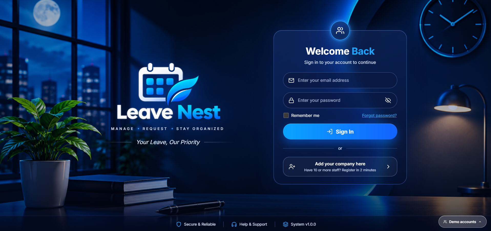
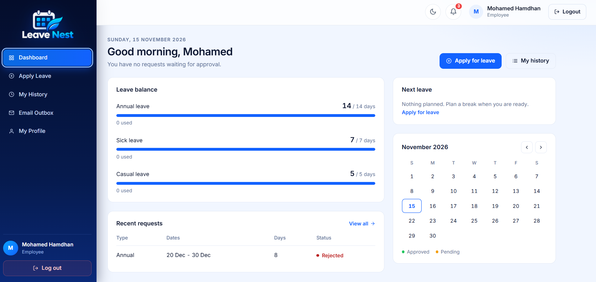
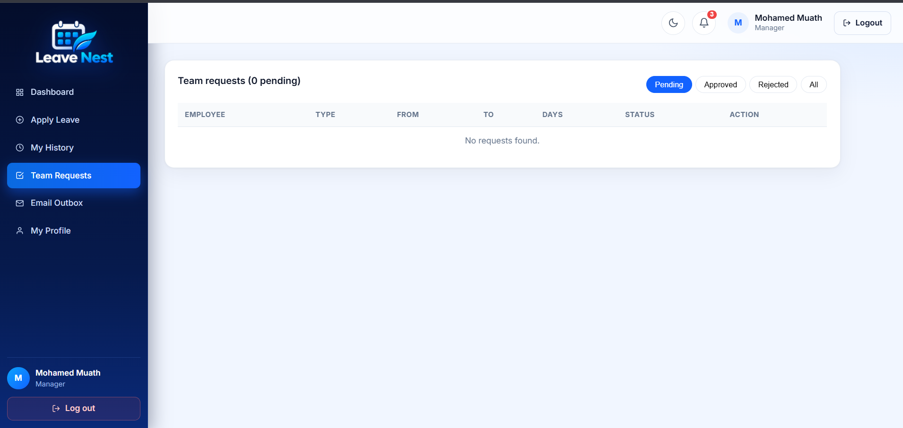
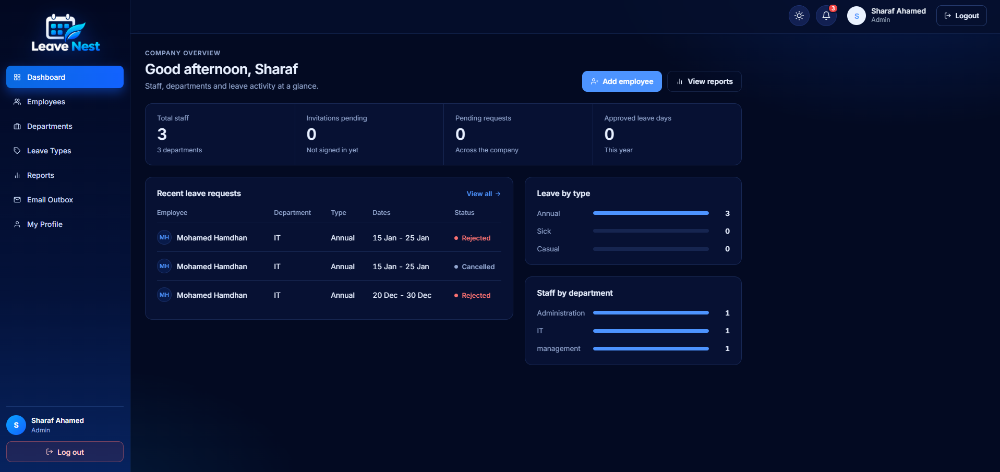

<div align="center">
# 🗓️ Staff Leave Management System (Leave Nest)
 
**A role-based web application to apply for, approve and track staff leave.**
 


 
HND in Computer Science · Full-Stack Web Application Development
 
</div>
---
 
## 📌 About the Project
 
Many organisations still manage leave with paper forms, emails or WhatsApp, which causes lost requests, wrong balances and no central record. **Leave Nest** replaces this with a single web application where:
 
- **Employees** apply for leave and track their balance and history
- **Managers** review, approve or reject their team's requests
- **Admins** manage employees, departments and reports
The core flow runs end to end on a real **MySQL** database through a **Node.js + Express REST API**.
 
## ✨ Features
 
### 👤 Employee
- Role-based dashboard with leave balances and recent requests
- Apply for leave with validation (weekends excluded, balance check, overlapping dates blocked)
- Leave history with status filters and cancel for pending requests
### 🧑‍💼 Manager
- Everything an employee can do
- Team Requests page with approve / reject (a comment is required on rejection)
- Dashboard with team pending count
### 🛠️ Admin
- Dashboard with staff, department and request statistics
- Add and manage employees (role, department, reporting manager), disable / enable accounts, resend invitation
- Manage departments (a department with staff cannot be deleted)
- Reports with filters (date, department, type, status) and **PDF export**
- Email Outbox: preview of invitation, leave request and decision emails
### 🔐 Security
- Login with **JWT** tokens
- Passwords stored as **bcrypt** hashes (never plain text)
- Temporary password for new employees (valid 7 days); a new strong password is compulsory at first login
- Role-based access in both the React routes and the backend API
- Parameterised SQL queries; every query is filtered by `company_id`
- Secrets kept in `.env` (not committed to Git)
### 🎨 UI / UX
- Modern glass-style login with show/hide password
- Fully responsive (desktop, tablet, mobile)
- Login details can be shared with a new employee through a WhatsApp link
## 🧰 Tech Stack
 
| Layer | Technology |
|---|---|
| Front end | React 19, Vite, React Router, React Icons, Context API |
| Back end | Node.js, Express.js (REST API) |
| Database | MySQL (`companies`, `users`, `departments`, `leave_requests`, `email_log`) |
| Security | JWT, bcrypt, role-based middleware |
| Reports | jsPDF, jspdf-autotable |
| Tools | Git, GitHub, VS Code, MySQL Workbench |
 
## 🖼️ Screenshots
 
| Login | Employee Dashboard |
|---|---|
|  |  |
 
| Manager: Team Requests | Admin Dashboard |
|---|---|
|  |  |
 
| Users | Reports |
|---|---|
|  |  |
 
## 📁 Project Structure
 
```
staff-leave-management-system/
├── docs/                 # Requirements, diagrams, wireframes, report
├── front-end/            # React application
│   └── src/
│       ├── components/   # Layout, Modal, StatCard, StatusBadge ...
│       ├── context/      # AuthContext
│       ├── pages/        # Login, dashboards, Apply, History, Approvals, Users ...
│       ├── routes/       # ProtectedRoute (role-based access)
│       └── api.js        # fetch wrapper for the REST API
├── back-end/             # Node.js + Express API
│   └── src/
│       ├── routes/       # auth, users, leaves, departments ...
│       ├── middleware/   # requireAuth, requireRole
│       └── db.js         # MySQL connection
└── README.md
```
 
## 🚀 Getting Started
 
### Prerequisites
- [Node.js](https://nodejs.org/) 18 or later
- MySQL 8 (with a database named `leavenest`)
- Git
### 1. Clone
 
```bash
git clone https://github.com/sharaf-official/staff-leave-management-system.git
cd staff-leave-management-system
```
 
### 2. Run the back end
 
```bash
cd back-end
npm install
```
 
Create a `back-end/.env` file with your MySQL connection details and a JWT secret (this file is not committed to Git), then:
 
```bash
npm run dev
```
 
The API runs on **http://localhost:5000**. Check **http://localhost:5000/api/health**; it should return `{"status":"ok","db":true}`.
 
### 3. Create the first admin account
 
There are no default accounts. Create the first admin and company with the reset script (this clears existing data):
 
```bash
node src/reset.js "Admin Name" admin@example.com "YourPassword1" "Company Name"
```
 
### 4. Run the front end
 
```bash
cd front-end
npm install
npm run dev
```
 
Open **http://localhost:5173** and sign in with the admin account you created. Add managers and employees from **Employees → Add employee**; each new user receives a temporary password and must set a new one at first login.
 
## 🗺️ Roadmap
 
- [x] **E1**: Requirements, use case diagram, ER design, architecture, wireframes
- [x] **E2**: React UI (login, 3 dashboards, apply, history, approvals, users, departments, leave types, reports)
- [x] **E3**: MySQL database, REST API, business logic, front-end integration
- [x] **E4 (core)**: JWT authentication, bcrypt, role-based authorisation, first-login flow
- [ ] Register Company backend (currently front-end demo)
- [ ] Leave Types backend (currently front-end demo)
- [ ] Real email with Nodemailer (currently previewed in Email Outbox)
- [ ] **E5**: Automated tests, deployment, documentation
- [ ] **Final**: Report, demo and viva
## 📄 Documentation
 
See the [`docs`](docs) folder for requirements, diagrams and wireframes.
 
## 👨‍💻 Author
 
**Sharaf Izam**
 
HND in Computer Science · Final Project · Upbright
 
| | |
|---|---|
| 🌐 Portfolio | [www.sharafizam.com](https://www.sharafizam.com) |
| 💻 GitHub | [@sharaf-official](https://github.com/sharaf-official) |
 
---
<div align="center">
⭐ Built as an academic full-stack project · 🌐 [www.sharafizam.com](https://www.sharafizam.com)
 
</div>
 
