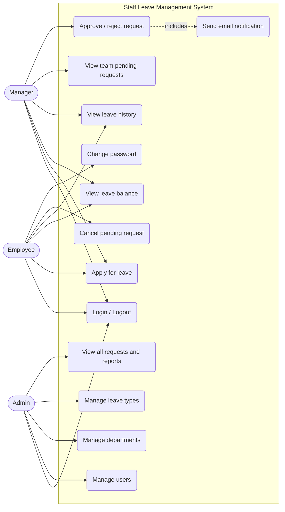
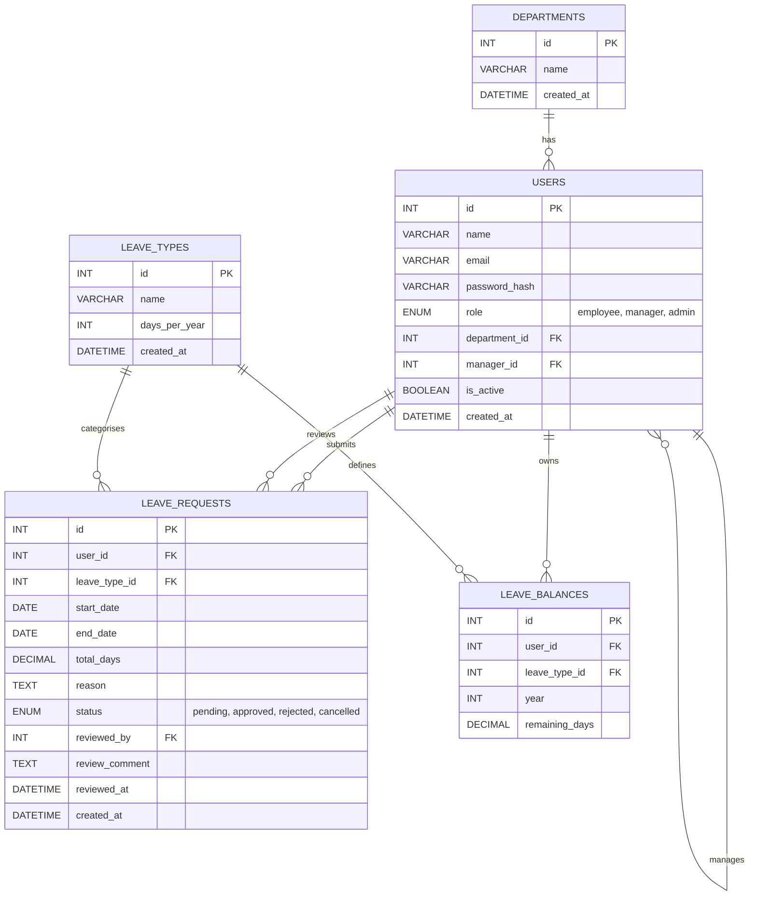
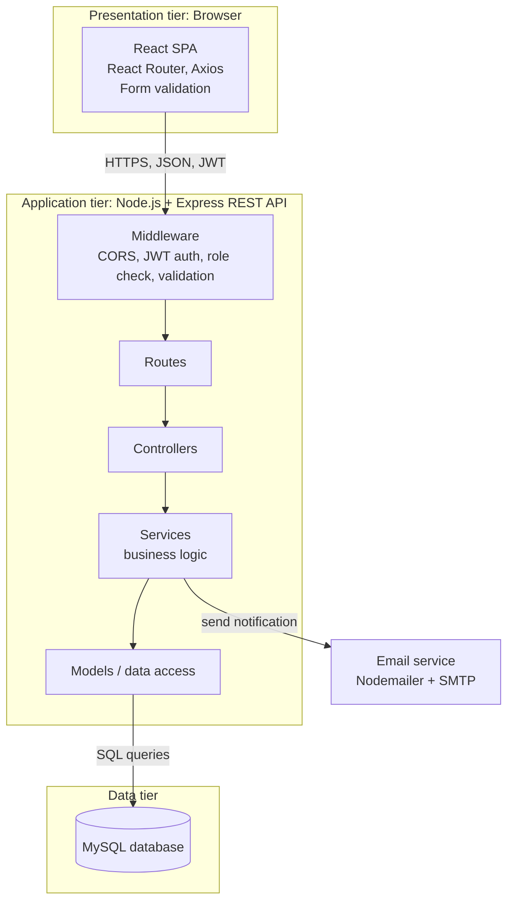
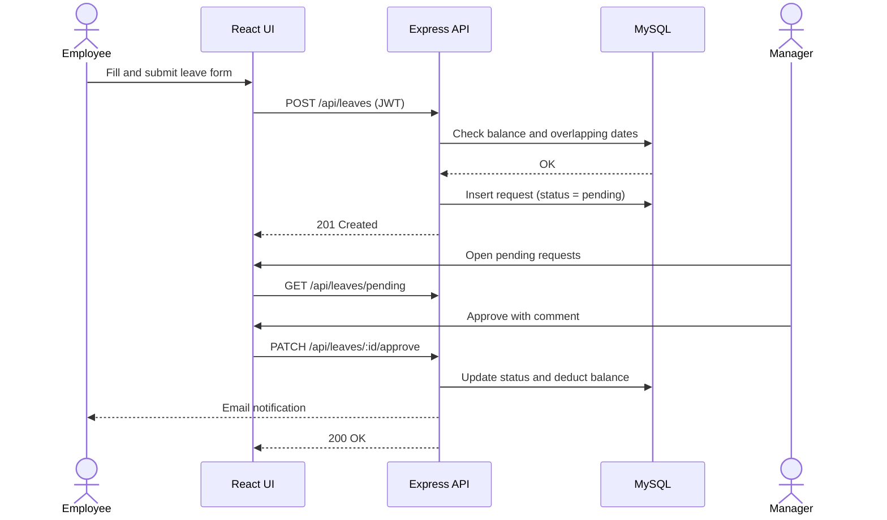

# Staff Leave Management System: Diagrams

These diagrams are written in Mermaid, so they render automatically when this file is viewed on GitHub. To use them in a report or slides, take a screenshot of each diagram or paste the code into https://mermaid.live and export as PNG/SVG.

---

## 1. Use Case Diagram (equivalent model)

---

## 2. Entity Relationship (ER) Diagram

### Entities and relationships (summary)

- A **department** has many **users**; each user belongs to one department.
- A **user** may manage many other users (self-relationship via `manager_id`).
- A **user** submits many **leave requests**; a request is reviewed by one manager/admin (`reviewed_by`).
- A **leave type** is used by many leave requests and balances.
- A **leave balance** links one user, one leave type and one year (unique combination).

---

## 3. Software Architecture Diagram

### Component responsibilities

| Component | Responsibility |
|---|---|
| React front end | Display pages, collect input, client-side validation, call the API |
| Express API | Authentication, authorisation, server-side validation, business logic, error handling |
| MySQL | Persistent storage, constraints and relationships |
| Email service | Send approval/rejection notifications |

### How components communicate

1. The browser sends HTTPS requests with JSON to the Express API; the JWT is sent in the `Authorization` header.
2. Middleware verifies the token and the user's role, then validates the input.
3. Controllers call services, which apply business rules and use models to query MySQL.
4. The API returns a JSON response with a status code; the front end updates the UI.
5. On approval or rejection, the service triggers an email through Nodemailer.

---

## 4. Leave Request Flow (supporting model)

